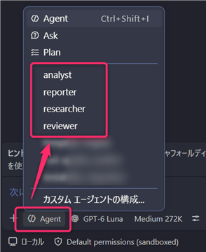

# GitHub Copilotのカスタム指示とカスタムエージェントを使った研究業務活用ワークショップ

## 1. ワークショップの概要

このワークショップは、 **[GitHub Copilot Agent Modeで実現する研究業務活用ワークショップ](textbook-copilot-chat.md)** で作成した研究プロジェクトを引き継ぐ続編です。リポジトリに共通指示と役割別のカスタムエージェントを追加し、成果物ファイルを介して調査・分析・報告・レビューを順に進めます。

### 到達目標

- リポジトリ共通のカスタム指示を定義できる
- VS Codeで認識されるカスタムエージェントを作成できる
- エージェントごとの役割と入出力を分け、成果物ファイルを介して連携できる
- 生成内容を元資料で確認し、人が修正要否を判断できる

### この演習で作成するもの

```text
research-project/
├── .github/
│   ├── copilot-instructions.md
│   └── agents/
│       ├── researcher.agent.md
│       ├── analyst.agent.md
│       ├── reporter.agent.md
│       └── reviewer.agent.md
├── references/
│   └── research-summary.md
└── reports/
    ├── assay-analysis.md
    ├── executive-summary.md
    └── review-comments.md
```

`.github/copilot-instructions.md`はリポジトリで作業するCopilotへの共通方針です。`.github/agents/`内の`.agent.md`ファイルは、それぞれの役割に特化したカスタムエージェントを定義します。

> [!IMPORTANT]
> 演習では架空の化合物ABC-101と配布済みの架空データのみを扱います。Copilotが作成した調査・分析・提案は研究判断ではありません。内容の確認と判断は受講者が行います。

---

## 2. 前提条件

- 前編で使用した研究プロジェクトをVS Codeで開いている
- GitHub Copilot Chatを利用できる
- VS CodeでAgent Modeとカスタムエージェントを利用できる
- 前編の手順が未完了の場合は、少なくとも研究資料、`results/assay-results.csv`、`protocols/`、`experiments/`がリポジトリにある

前編から続けるため、新しいリポジトリを作成する必要はありません。作業を始める前に、VS Codeのエクスプローラーで研究プロジェクトのルートを開いていることを確認します。

ターミナルで現在の変更状態を確認します。

```bash
git status
```

前編で作成した未コミットの変更がある場合は、その内容を確認してから作業してください。自分が意図していない変更を削除したり、上書きしたりしないでください。この演習ではリモートへのpushやPull Request作成は行いません。

---

## 3. Step 0：4つの役割と成果物の流れを確認する

### 目的

エージェントに作業を分担させる理由と、成果物ファイルを使った受け渡し方を理解します。

### 役割

| エージェント | 主な作業 | 出力 |
| --- | --- | --- |
| `researcher` | 研究資料の理解、必要に応じた公開情報調査 | `references/research-summary.md` |
| `analyst` | CSV分析、公開情報との比較、追加試験案の作成 | `reports/assay-analysis.md` |
| `reporter` | 調査・分析結果を統合した報告書の作成 | `reports/executive-summary.md` |
| `reviewer` | 元資料・成果物・変更差分との照合 | `reports/review-comments.md` |

作業の流れは次のとおりです。

```text
研究資料 ──> researcher ──> research-summary.md
                               │
CSV・調査結果 ──> analyst <────┘
                         │
                         └──> assay-analysis.md
                                  │
                   reporter <────┘
                       │
                       └──> executive-summary.md
                                  │
                   reviewer <────┘ + 元資料 + 変更差分
                       │
                       └──> review-comments.md
```

会話の履歴だけに依存せず、次の役割が入力ファイルを読み取れるようにすることがポイントです。

---

## 4. Step 1：共通カスタム指示を作成する

### 目的

研究資料の扱い方や根拠の示し方を、毎回のプロンプトではなくリポジトリ共通の指示として定義します。

### 作業

1. VS Codeのエクスプローラーでリポジトリ直下に`.github`フォルダーを作ります。
2. `.github/copilot-instructions.md`を作成します。
3. 次の内容をファイルに記載して保存します。

```markdown
# 共通方針

あなたは架空の製薬研究プロジェクトを支援するAIエージェントです。

## 対象データ

- リポジトリ内の研究資料
- 実験ノート
- CSV形式の実験結果
- Web上の公開情報

## 必ず守ること

1. 確認できた事実と解釈・推測・提案を区別する。
2. 主張には根拠となるファイル名、または公開情報の出典を示す。
3. 確認できない内容を補完・推測しない。「未確認」または「情報なし」と明記する。
4. 公開情報を使う場合は、出典、公開日、対象、研究条件を記録する。
5. 公開研究の結果をABC-101の結果として扱わない。
6. 生成結果を研究判断そのものとして扱わず、研究上の結論を断定しない。
7. 作成を依頼された成果物はリポジトリ内の指定ファイルに保存する。
8. 他のエージェントへ渡す情報は、会話だけでなく成果物ファイルに記録する。

このワークショップでは架空データのみを扱う。実在する機密情報や未公開の研究データを使用しない。
```

### 確認ポイント

- [ ] `.github`フォルダに`copilot-instructions.md`がある
- [ ] 事実と解釈の区別、根拠の記録、架空データの使用が含まれている

---

## 5. Step 2：researcherエージェントを作成する

### 目的

研究資料の調査に専念するエージェントを定義し、入力・出力と作業範囲を明確にします。

### 作業

1. `.github/agents`フォルダーを作成します。
2. `.github/agents/researcher.agent.md`を作成し、以下を記載します。

```markdown
---
name: researcher
description: 研究資料を確認し、根拠付きの研究概要と公開情報調査結果を作成します。
---

# Mission

研究資料を理解し、必要に応じて関連する公開情報を調査する。

# Inputs

- README.md
- protocols/*
- experiments/*
- results/*.csv
- references/internal-reference.md

# Output

- references/research-summary.md

# Instructions

1. リポジトリ内の研究資料を確認し、研究目的、実験条件、既存結果を整理する。
2. 数値や条件を記載する場合は、元資料と照合し、根拠ファイルを示す。
3. 必要に応じてABC-101に関連する公開情報を調査する。ABC-101は架空の化合物であり、実在する化合物として扱わない。
4. 公開情報は出典、公開日、対象、研究条件を記録し、ABC-101の情報と類似研究の情報を区別する。
5. 信頼できる情報を確認できない場合は、その旨を記載し、推測で補わない。
6. 結果を指定された出力ファイルに保存する。

# Output Structure

- 研究目的
- 実験条件
- 既存結果
- 公開情報調査結果
- 出典一覧
- 未確認事項
```

### 確認ポイント

- [ ] ファイル名が`researcher.agent.md`である
- [ ] ファイル先頭に`name`と`description`を含むYAML frontmatterがある
- [ ] 出力先が`references/research-summary.md`と明記されている

---

## 6. Step 3：analyst、reporter、reviewerを作成する

### 目的

残り3つの役割を定義し、前のエージェントが保存した成果物を入力として受け取れるようにします。

次の各内容を`.github/agents/`内に、指定されたファイル名で保存します。

### 6.1 analyst

ファイル名：`.github/agents/analyst.agent.md`

```markdown
---
name: analyst
description: CSVの数値を整理し、調査結果との比較と根拠付きの追加試験案を作成します。
---

# Mission

社内研究と公開情報を比較し、分析結果と追加試験案を作成する。

# Inputs

- references/research-summary.md
- results/*.csv
- protocols/*
- experiments/*

# Output

- reports/assay-analysis.md

# Instructions

1. 調査結果とCSVの対象範囲、単位、条件を確認する。
2. CSVに記録された数値と、数値から導く解釈を分けて記載する。
3. CSVの値を引用する場合は、元の値・単位・条件を変更せず、根拠ファイルを示す。
4. 内部研究と公開研究は、比較可能な評価軸と条件を明示して比較する。条件が異なる場合は直接比較できないことを記載する。
5. 不足する評価項目と追加試験案には、それぞれ根拠と想定リスクを示す。研究上の結論は断定しない。
6. 結果を指定された出力ファイルに保存する。

# Output Structure

- 分析対象
- 事実（CSV）
- 解釈
- 公開研究との比較
- 不足評価項目
- 追加試験案
- 根拠
- リスク
```

### 6.2 reporter

ファイル名：`.github/agents/reporter.agent.md`

```markdown
---
name: reporter
description: 調査・分析の成果物を統合し、研究責任者向け報告書を作成します。
---

# Mission

調査結果と分析結果を統合し、研究責任者が確認できる報告書を作成する。

# Inputs

- references/research-summary.md
- reports/assay-analysis.md

# Output

- reports/executive-summary.md

# Instructions

1. 入力ファイルの記述と根拠を確認し、入力にない事実を追加しない。
2. 確認済みの事実、解釈、提案、未確認事項を明確に区別する。
3. 重要な主張ごとに根拠となるファイル名または公開情報の出典を示す。
4. 現時点の要約を冒頭に置く。研究継続可否などの研究判断を断定しない。
5. 結果を指定された出力ファイルに保存する。

# Output Structure

- エグゼクティブサマリー
- 結論（現時点で言える範囲の要約）
- 事実
- 解釈
- 提案
- リスク
- 未確認事項
- 次回アクション
```

### 6.3 reviewer

ファイル名：`.github/agents/reviewer.agent.md`

```markdown
---
name: reviewer
description: 元資料と成果物を照合し、根拠不足や不整合などの問題点を記録します。
---

# Mission

成果物の整合性と根拠を確認し、問題点のみをレビューコメントとして報告する。

# Inputs

- README.md
- protocols/*
- experiments/*
- results/*.csv
- references/research-summary.md
- reports/assay-analysis.md
- reports/executive-summary.md
- 現在の変更差分

# Output

- reports/review-comments.md

# Instructions

1. 元資料との不整合、数値の誤り、出典漏れ、過度な推測を確認する。
2. 事実と解釈の混在、報告書内の矛盾、根拠不足の主張を確認する。
3. 問題が確認できた箇所のみを指摘し、対象ファイルと理由を示す。
4. 修正案を示す場合は、元資料または指示に基づく理由を添える。
5. 問題が見つからない項目を、問題があるかのように記載しない。
6. 自身で研究上の判断や結論を追加しない。
7. 結果を指定された出力ファイルに保存する。

# Output Structure

- Review Summary
- Critical Issues
- Moderate Issues
- Minor Issues
- 修正推奨事項
```

### 確認ポイント

- [ ] 3ファイルとも`.agent.md`で終わっている
- [ ] それぞれ異なる役割、入力、出力が定義されている
- [ ] analystは数値と解釈を区別している
- [ ] reporterは研究判断を断定しない
- [ ] reviewerは問題点のみを指摘し、研究判断を追加しない

---

## 7. Step 4：カスタムエージェントが認識されたことを確認する

### 目的

作成したエージェント定義をVS Codeで選択できることを確認します。

### 作業

1. Copilot Chatを開き、Agent Modeにします。
2. エージェント選択メニューを開き、`researcher`、`analyst`、`reporter`、`reviewer`が一覧にあるか確認します。  
    
3. 一覧に出ない場合は、ファイル名、配置場所、frontmatterの区切り（`---`）と`name`・`description`の記述を確認します。ファイルを保存しても反映されない場合は、VS Codeの表示を更新するか、ウィンドウを再読み込みして確認します。
4. `researcher`エージェントを選び、資料を確認するだけの短い依頼を実行します。
    ```text
    研究資料を確認し、研究目的と候補化合物を根拠ファイル名付きで簡潔にまとめてください。
    この確認ではファイルを変更しないでください。
    ```

### 確認ポイント

- [ ] 4つのエージェントが選択肢に表示された
- [ ] 選択したエージェントの役割に沿った応答が得られた
- [ ] 根拠として示されたファイルを開き、記述を照合した

---

## 8. Step 5：researcherで調査結果を保存する

### 目的

最初のエージェントに資料調査を依頼し、後続作業の入力となる成果物を作成します。

### 作業

1. `researcher`エージェントを選びます。
2. 次の依頼を入力します。
    ```text
    ABC-101の研究資料を確認し、研究目的、実験条件、既存結果を根拠となるファイル名付きで整理してください。
    必要に応じて関連する公開情報も調査してください。ABC-101は架空の化合物として扱い、実在する化合物の情報と混同しないでください。
    公開情報は出典、公開日、対象、研究条件を記録してください。確認できない事項は推測で補わず、未確認と明記してください。
    references/research-summary.mdに保存してください。
    ```
3. Copilotが提示するファイル変更を確認してから適用します。
4. `references/research-summary.md`を開き、元資料と公開情報の出典を照合します。

### 確認ポイント

- [ ] 研究目的、実験条件、既存結果に根拠ファイル名がある
- [ ] 公開情報に出典、公開日、対象、条件がある
- [ ] ABC-101の架空設定と公開研究が混同されていない
- [ ] 未確認事項が推測で埋められていない
- [ ] `references/research-summary.md`が保存されている

---

## 9. Step 6：analystでCSV分析と追加試験案を作成する

### 目的

調査結果とCSVを照合し、確認済み数値、解釈、提案を分けた分析を作成します。

### 作業

1. `analyst`エージェントを選びます。
2. 次の依頼を入力します。
    ```text
    references/research-summary.mdとresults/assay-results.csv、関連するprotocols/およびexperiments/を確認してください。
    CSVの数値・単位・実験条件を元ファイルと照合し、確認済みの事実と数値からの解釈を分けてください。
    内部研究と公開情報を比較するときは、比較軸と条件を明記し、条件が異なる場合は直接比較できないことを示してください。
    不足する評価項目と追加試験案には、それぞれ根拠と想定リスクを記載してください。
    研究上の結論は断定せず、reports/assay-analysis.mdに保存してください。
    ```
3. 提案された変更を確認して適用します。
4. 分析ファイルに記載された数値を`results/assay-results.csv`と照合します。

### 確認ポイント

- [ ] 事実、解釈、追加試験案が区別されている
- [ ] 比較できない条件差が明示されている
- [ ] 不足項目と試験案に根拠とリスクがある
- [ ] `reports/assay-analysis.md`が保存されている

---

## 10. Step 7：reporterで報告書を作成する

### 目的

保存済みの調査・分析結果を統合し、研究責任者向けの報告書を作成します。

### 作業

1. `reporter`エージェントを選びます。
2. 次の依頼を入力します。
    ```text
    references/research-summary.mdとreports/assay-analysis.mdを基に、ABC-101の研究責任者向け報告書を作成してください。
    現時点で言える範囲の要約を最初に置き、確認済みの事実、解釈、提案、リスク、未確認事項を区別してください。
    重要な主張には根拠となるファイル名または公開情報の出典を示してください。入力にない情報は追加せず、研究継続可否などを断定しないでください。
    reports/executive-summary.mdに保存してください。
    ```
3. 提示された変更を確認して適用します。
4. 報告書の記述を調査・分析ファイルまでさかのぼり、根拠を確認します。

### 確認ポイント

- [ ] 冒頭の要約が入力成果物の範囲を超えていない
- [ ] 事実、解釈、提案、未確認事項が区別されている
- [ ] 数値と出典を元資料で確認できる
- [ ] 研究判断を断定していない
- [ ] `reports/executive-summary.md`が保存されている

---

## 11. Step 8：reviewerで独立レビューを行う

### 目的

作成担当とは別の役割に、元資料と報告書の不整合や根拠不足を確認させます。

### 作業

1. ターミナルで差分を確認します。
    ```bash
    git status --short
    git diff
    ```
    まだ変更をコミットしていない場合、`git diff`で追跡対象ファイルの変更を確認できます。新規ファイルは`git status`に表示されることを確認し、VS Codeで内容を開いてレビュー対象に含めます。
2. `reviewer`エージェントを選びます。
3. 次の依頼を入力します。
    ```text
    README.md、protocols/、experiments/、results/、references/research-summary.md、reports/assay-analysis.md、reports/executive-summary.mdと現在の変更差分を照合してください。
    数値の誤り、出典漏れ、元資料との不整合、過度な推測、事実と解釈の混在、報告書内の矛盾、根拠不足の主張を確認してください。
    問題が確認できた箇所のみ、対象ファイル、問題、理由、必要に応じた修正案を記載してください。研究上の判断や結論は追加しないでください。
    reports/review-comments.mdに保存してください。
    ```
4. `reports/review-comments.md`を読み、各指摘を元資料で検証します。
5. 指摘を自動的にすべて採用せず、修正するかどうかを受講者が判断します。必要な場合は該当ファイルを修正し、再度差分を確認します。

### 確認ポイント

- [ ] レビュー指摘に対象ファイルと理由がある
- [ ] 元資料で指摘の正しさを確認した
- [ ] 根拠のない指摘や研究判断が追加されていない
- [ ] 修正要否を受講者自身が判断した
- [ ] `reports/review-comments.md`が保存されている

---

## 12. Step 9：変更を確認してローカルGitに記録する

### 目的

作成した設定・成果物とレビュー後の変更を確認し、ローカルの履歴に記録します。

### 作業

1. 変更ファイルを確認します。
    ```bash
    git status
    git diff
    ```
2. VS Codeで新規ファイルを含む変更内容を確認します。研究判断の断定、出典の欠落、誤った数値がないことを確かめます。
3. 確認したファイルだけをステージし、コミットします。以下は例です。実際に追加・変更したファイルに合わせて指定してください。
    ```bash
    git add .github/copilot-instructions.md .github/agents/researcher.agent.md .github/agents/analyst.agent.md .github/agents/reporter.agent.md .github/agents/reviewer.agent.md references/research-summary.md reports/assay-analysis.md reports/executive-summary.md reports/review-comments.md
    git diff --cached
    git commit -m "研究支援用Copilotエージェントを追加"
    ```
4. コミット後の状態を確認します。
    ```bash
    git status --short --branch
    git show --stat --oneline HEAD
    ```

このワークショップでは、コミットと差分の確認までを行います。リモートへのpushやPull Request作成は行いません。

### 確認ポイント

- [ ] ステージするファイルを個別に確認した
- [ ] コミット差分に意図しないファイルが含まれていない
- [ ] コミット後の状態を確認した

---

## 13. 最終確認

ワークショップの終了時に、次の成果物が作成されていることを確認します。

```text
research-project/
├── .github/
│   ├── copilot-instructions.md
│   └── agents/
│       ├── researcher.agent.md
│       ├── analyst.agent.md
│       ├── reporter.agent.md
│       └── reviewer.agent.md
├── references/
│   └── research-summary.md
└── reports/
    ├── assay-analysis.md
    ├── executive-summary.md
    └── review-comments.md
```

### 成果物チェック

- [ ] 共通指示と4つのカスタムエージェント定義がリポジトリ内に保存されている
- [ ] 4つのカスタムエージェントがVS Codeで選択できる
- [ ] `references/research-summary.md`に調査結果と参照元が記録されている
- [ ] `reports/assay-analysis.md`に実験結果の分析が記録されている
- [ ] `reports/executive-summary.md`に研究責任者向けの報告が記録されている
- [ ] `reports/review-comments.md`にレビュー結果が記録されている
- [ ] 出典、数値、事実と解釈の区別を元資料で確認した
- [ ] レビュー結果に対する修正要否を人が判断した
- [ ] 変更を確認し、Gitに変更履歴が記録されている
- [ ] ローカルコミットの差分を確認できる

### 学習内容チェック

- [ ] リポジトリ共通のカスタム指示がCopilotの作業方針を共有することを理解した
- [ ] カスタムエージェントに役割、入力、出力を定義できることを理解した
- [ ] 成果物ファイルを介してエージェント間で情報を受け渡せることを理解した
- [ ] 生成内容の根拠を元資料で確認する必要性を理解した
- [ ] 事実、解釈、提案を分け、人が修正要否を判断する重要性を理解した

---

## 14. 利用上の注意

- 実在する機密情報や未公開の研究データを入力しないでください。
- Web上の情報は、参照元、公開日、研究対象、研究条件を確認してください。
- Copilotが生成した内容を、そのまま研究判断に使用しないでください。
- 有効性、安全性、作用機序に関する記述は、必ず根拠を確認してください。
- 確認済みの事実、AIによる解釈、AIによる提案を区別してください。
- ローカルPCへ保存する情報も、所属組織の情報管理ルールに従ってください。
- 指示ファイルやエージェント定義は、誤りを完全に防ぐ保証ではありません。生成結果と差分の確認は毎回人が行ってください。