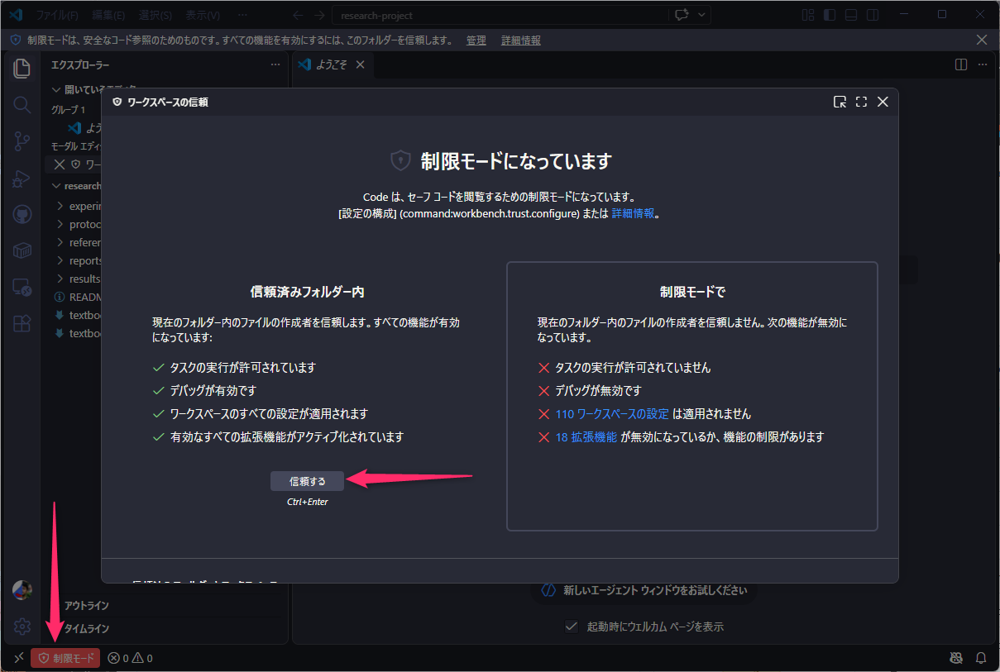
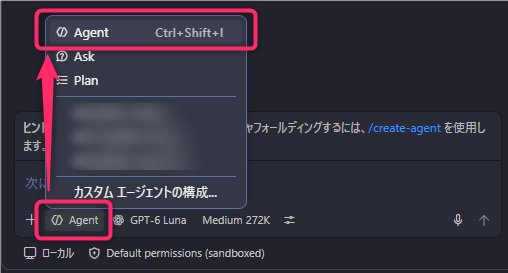

# GitHub Copilot Agent Modeで実現する研究業務のAIエージェント活用ワークショップ

## 1. ワークショップの概要

このワークショップでは、GitHub Copilot Agent Modeを、プログラム作成ではなく**研究業務を支援するAIエージェント**として使用します。

参加者は、架空の薬品研究企業で抗炎症化合物を研究する担当者として、新規候補化合物 **ABC-101** の研究プロジェクトに取り組みます。配布された研究資料をGitHub Copilotに読み取らせ、公開情報の調査、実験結果の分析、報告書の作成、ローカルGitでの変更履歴管理までを体験します。

### このワークショップで体験すること

1. ローカルGitリポジトリに格納された研究資料を確認する
2. GitHub Copilotに研究内容を整理させる
3. Web上の公開情報を調査する
4. 社内研究と公開情報を比較する
5. CSV形式の実験結果を分析する
6. 研究責任者向け報告書を作成する
7. Gitで変更履歴を記録する
8. ローカルGitで変更を記録し、差分をレビューする

### 到達目標

ワークショップ終了後、次の状態になることを目指します。

- GitHub Copilot Agent Modeの特徴を説明できる
- ローカルGitを研究資料や成果物の変更履歴管理に利用できる
- 複数ファイルを対象とした調査や整理をCopilotへ依頼できる
- リポジトリ内の情報とWeb上の公開情報を組み合わせて比較できる
- AIが生成した事実、解釈、提案を区別して確認できる
- Gitの基本操作を使って変更履歴を記録できる

---

## 2. 参加者の前提環境・ツール

### 必要な環境

- GitHubアカウント
- GitHub Copilotを利用できるライセンス
- GitHub Copilot ChatとAgent Modeを利用できるVisual Studio Code
- Git
- Webブラウザー
- インターネット接続

### 当日配布するもの

当日は、次の内容を含むZIPファイルを配布します。

- 演習用ローカルGitリポジトリ一式（リモート未設定）
- 本トレーニング手順
- 架空の研究資料
- 架空の実験結果

### 開始前の確認

- [ ] GitHubへサインインできる
- [ ] Visual Studio Codeを起動できる
- [ ] Visual Studio CodeでGitHub Copilot Chatを開ける
- [ ] Copilot ChatでAgent Modeを選択できる
- [ ] ターミナルを開ける
- [ ] `git --version` を実行するとバージョン情報が表示される

> [!IMPORTANT]
> 本ワークショップでは、架空の化合物、研究資料、実験結果のみを使用します。実在する機密情報や未公開の研究データは入力しないでください。

---

## 3. 演習用ファイルの準備

### 3.1 ZIPファイルを展開する

1. 講師から配布されたZIPファイルをPCへ保存します。
2. ZIPファイルを `research-project` フォルダーとして展開します。

フォルダー構成は次のとおりです。

```text
research-project/
├── README.md
├── protocols/
│   ├── protocol-a.md
│   └── protocol-b.md
├── experiments/
│   ├── experiment-001.md
│   ├── experiment-002.md
│   └── experiment-003.md
├── results/
│   └── assay-results.csv
├── references/
│   └── internal-reference.md
└── reports/
```

### 3.2 Visual Studio Codeで開く

1. Visual Studio Codeを起動します。
2. **［ファイル］→［フォルダーを開く］** を選択します。
3. 展開した `research-project` フォルダーを選択します。
4. 制限モードが有効になっている場合は、フォルダーを信頼する設定を行う。
    
5. 左側のエクスプローラーに研究資料が表示されることを確認します。

### チェックポイント

- [ ] `research-project` フォルダーを開いている
- [ ] `README.md`、`protocols`、`experiments`、`results`、`references`、`reports` が表示される
- [ ] GitHub Copilot Chatを開ける
- [ ] Agent Modeを選択できる

---

## 4. Step 0：GitHub Copilot Agent Modeを理解する

### 目的

通常のチャットとAgent Modeの違いを確認します。

Agent Modeは、質問に回答するだけでなく、リポジトリ内の複数ファイルを探索し、内容を関連付け、必要に応じてファイルを作成・変更します。ただし、生成結果が正しいとは限らないため、最終的な確認は人が行います。

### 作業手順

1. GitHub Copilot Chatを開きます。
2. モード選択から**Agent**を選択します。
    
3. 次の指示を入力します。
    ```text
    このリポジトリを確認し、どのような研究が行われているか説明してください。
    次の観点で整理してください。
    - 研究目的
    - 研究対象
    - 実験方法
    - 現在までに得られている結果
    - 不足している情報
    ```
4. Copilotが参照したファイルを確認します。
5. 回答に、配布資料に書かれていない内容が追加されていないか確認します。

### チェックポイント

- [ ] Copilotが複数のファイルを確認した
- [ ] 研究目的、研究対象、実験方法、結果が整理された
- [ ] 不足情報が「不明」または「未確認」として扱われている
- [ ] 回答の根拠を元ファイルで確認した

---

## 5. Step 1：ローカルGitの基本を確認する

### 目的

研究資料の変更履歴を記録するために、最低限のGit操作を体験します。

- **リポジトリ**：研究資料や成果物をまとめて管理する場所
- **コミット**：変更内容を履歴として記録する操作

### 5.1 現在の状態を確認する

Visual Studio Codeでターミナルを開き、次を実行します。

```bash
git init
git status
git remote -v
```

`git remote -v` に何も表示されないことを確認します。この演習ではローカルリポジトリだけを使用し、リモートの追加やプッシュは行いません。

### 5.2 研究ノートを追加する

講師の指示に従い、指定された研究ノートを追加または編集します。保存後、再度状態を確認します。

```bash
git status
```

### 5.3 変更を記録する

```bash
git add .
git commit -m "実験ノートを追加"
```

### チェックポイント

- [ ] `git init` でリポジトリが初期化された
- [ ] `git status` で変更ファイルを確認できた
- [ ] `git add .` を実行した
- [ ] `git commit` が完了した
- [ ] コミットメッセージから変更内容を理解できる

---

## 6. Step 2：研究内容を整理する

### 目的

リポジトリ内の研究資料をCopilotに読み取らせ、現在の研究状況を整理します。

### 作業手順

1. Copilot ChatでAgent Modeを選択します。
2. 次の指示を入力します。
    ```text
    リポジトリ内の研究資料を確認し、現在の研究状況を整理してください。
    次の観点を含めてください。
    - 研究目的
    - 候補化合物
    - 評価項目
    - 実験方法
    - 現時点の成果
    - 未確認の事項

    記載内容の根拠となるファイル名も示してください。
    ```
3. 回答に示されたファイル名を選択し、実際の記載内容と一致するか確認します。
4. 続けて、次の指示を入力します。
    ```text
    研究資料の間に、数値、評価条件、結論の不一致がないか確認してください。
    不一致または情報不足がある場合は、該当ファイルと確認すべき内容を一覧にしてください。
    ```
5. Copilotが指摘した不一致や不足を元ファイルで確認します。

### チェックポイント

- [ ] 研究目的と候補化合物が整理された
- [ ] 評価項目と実験方法が整理された
- [ ] 各説明に根拠となるファイル名が示された
- [ ] 不一致と情報不足が区別された
- [ ] Copilotの指摘を元ファイルで確認した

---

## 7. Step 3：公開情報を調査する

### 目的

Web上の公開情報を調査し、出典とともに整理します。

> [!IMPORTANT]
> ABC-101は架空の候補化合物です。ABC-101そのものの信頼できる公開情報が見つからない場合があります。見つからない情報を推測で補わず、「確認できない」と記載させてください。

### 7.1 単純なWeb調査

次の指示を入力します。

```text
候補化合物ABC-101に関連する公開情報をWebで調査してください。
次の観点で整理してください。
- 化合物または類似化合物の概要
- 想定される作用機序
- 関連する研究
- 有効性に関する情報
- 安全性に関する情報
- 研究上の注意点

各情報には、参照元のタイトル、URL、公開日を付けてください。
確認できない情報は、推測せず「確認できない」と記載してください。
```

調査結果について、次を確認します。

- 参照元のタイトルがあるか
- URLがあるか
- 公開日があるか
- ABC-101に関する事実と類似研究の情報が混在していないか

### 7.2 比較調査

続けて、次の指示を入力します。

```text
ABC-101と類似する候補化合物または既存研究を調査し、比較してください。
次の観点で比較表を作成してください。
- 想定される作用機序
- 有効性
- 安全性
- 研究の進展状況
- 公開されている研究情報の量
- ABC-101との主な相違点

比較に使用した情報源を明記してください。
```

### 7.3 調査結果を保存する

次の指示を入力します。

```text
これまでの調査結果を整理し、次のファイルとして保存してください。

保存先:
references/research-summary.md

記載項目:
- 調査目的
- 調査方法
- 調査結果の要約
- 主要な公開研究
- 比較結果
- 研究上の注意点
- 情報が不足している事項
- 参照元一覧
```

Copilotからファイル変更の確認を求められた場合は、変更内容を確認してから承認します。

### チェックポイント

- [ ] 調査結果に参照元のタイトル、URL、公開日がある
- [ ] 確認できない情報が推測で補われていない
- [ ] ABC-101と類似研究が明確に区別されている
- [ ] 比較表が共通の評価軸で整理されている
- [ ] `references/research-summary.md` が作成された
- [ ] 保存された内容を開いて確認した

---

## 8. Step 4：社内研究と公開情報を比較する

### 目的

リポジトリ内の研究情報と、前のステップで保存した公開情報を組み合わせて分析します。

### 8.1 情報を比較する

次の指示を入力します。

```text
次の情報を比較してください。
- リポジトリ内の実験計画書
- リポジトリ内の研究ノート
- references/research-summary.mdに保存した公開情報の調査結果

次の観点で整理してください。
- 社内研究と公開情報が一致している点
- 社内研究と公開情報が異なる点
- 社内研究で不足している評価項目
- 追加確認が必要な事項
- 現時点で判断できない事項

根拠となるファイルまたは情報源を明記してください。
```

### 8.2 追加試験案を作成する

次の指示を入力します。

```text
社内の研究内容と公開研究を比較し、次の研究計画案を作成してください。
- 追加すべき評価項目
- 実施を検討すべき追加試験
- 試験を行う理由
- 想定されるリスク
- 判断に必要な追加情報

提案と確認済みの事実を明確に分けて記載してください。
```

### チェックポイント

- [ ] 社内情報と公開情報が区別されている
- [ ] 一致点と相違点に根拠が示されている
- [ ] 不足している評価項目が整理されている
- [ ] 「確認済みの事実」と「提案」が分けられている
- [ ] 現時点で判断できない事項が明記されている

---

## 9. Step 5：実験結果を分析する

### 目的

CSV形式の測定結果を読み取り、特徴や確認事項を整理します。

### 作業手順

1. `results/assay-results.csv` を開き、列名とデータ内容を確認します。
2. Copilot Chatで次の指示を入力します。
    ```text
    results/assay-results.csvを分析してください。
    次の内容をまとめてください。
    - 化合物ごとの主要な測定結果
    - 有望と考えられる候補
    - 他と大きく異なる測定値
    - データが不足している項目
    - 追加確認が必要な測定結果
    - 次回試験で確認すべき事項

    分析結果はreports/assay-analysis.mdとして保存してください。
    ```
3. 続けて、次の追加指示を入力します。
    ```text
    分析結果について、確認済みの事実、データから導いた解釈、今後の提案を分けて記載してください。
    ```
4. `reports/assay-analysis.md` を開き、元のCSVと数値が一致するか確認します。

### チェックポイント

- [ ] `results/assay-results.csv` が分析対象になっている
- [ ] 化合物ごとの主要な測定結果が整理されている
- [ ] 元のCSVと報告された数値が一致している
- [ ] 欠損値や異常値の可能性が明記されている
- [ ] 事実、解釈、提案が分けられている
- [ ] `reports/assay-analysis.md` が作成された

---

## 10. Step 6：研究責任者向け報告書を作成する

### 目的

これまでの調査と分析を統合し、意思決定者が確認しやすい報告書を作成します。

### 作業手順

次の指示を入力します。

```text
リポジトリ全体を確認し、研究責任者向けの研究報告書を作成してください。

対象:
研究部門の責任者

目的:
候補化合物ABC-101の研究継続について判断するため

構成:
1. 結論
2. 研究目的
3. 実施した実験
4. 主要な実験結果
5. 公開研究との比較
6. 有望性
7. リスクと未確認事項
8. 追加で実施すべき試験
9. 推奨する次回アクション
10. 参照情報

条件:
- 結論を最初に記載する
- 専門用語には簡潔な説明を加える
- 事実、解釈、提案を区別する
- 根拠となるファイルと公開情報を明記する
- 確認できない内容は断定しない

保存先:
reports/executive-summary.md
```

作成後、次の順序で確認します。

1. 結論が最初に書かれているか
2. 実験結果の数値が元データと一致するか
3. 公開情報に出典があるか
4. 有望性を断定しすぎていないか
5. リスクと未確認事項が省略されていないか
6. 提案が確認済みの事実として書かれていないか

### チェックポイント

- [ ] `reports/executive-summary.md` が作成された
- [ ] 結論が冒頭にある
- [ ] 主要な実験結果に根拠がある
- [ ] 公開研究との比較に参照元がある
- [ ] 事実、解釈、提案、未確認事項が区別されている
- [ ] 研究継続をAIだけで断定していない

---

## 11. Step 7：変更を記録し、ローカルでレビューする

### 目的

Copilotが作成した成果物をローカルGitの変更履歴として記録し、コミット差分を確認してレビューします。

### 11.1 作業用ブランチを作成する

ターミナルで次を実行します。

```bash
git switch -c feature/additional-study
```

### 11.2 報告書へ追加試験計画を追記する

Copilot Chatで次の指示を入力します。

```text
reports/executive-summary.mdに、追加試験計画の章を追記してください。
次の項目を含めてください。
- 試験目的
- 仮説
- 評価項目
- 判定方法
- 想定されるリスク

既存の報告書と表現を統一してください。
```

変更内容を確認し、問題がなければ保存します。

### 11.3 変更をコミットする

```bash
git status
git add reports/executive-summary.md
git commit -m "追加試験計画を報告書へ追記"
```

### 11.4 ローカルで差分を確認する

次のコマンドで、作成したコミットと報告書の差分を確認します。

```bash
git status --short --branch
git show --stat --oneline HEAD
git show --format= HEAD -- reports/executive-summary.md
```

変更されたファイル、追加・削除された内容、変更理由が意図どおりか確認します。

### 11.5 Copilotにローカルの変更をレビューさせる

次の指示を入力します。

```text
`git diff HEAD^ HEAD -- reports/executive-summary.md`で確認できる今回の変更内容をレビューしてください。
次の観点で問題を確認してください。
- 実験結果との矛盾
- 調査結果との矛盾
- 根拠が不足している主張
- 事実と提案の混在
- 研究責任者に伝わりにくい表現

問題がある場合は、該当箇所と修正案を示してください。
```

指摘内容を元ファイルと照合し、必要な修正だけを反映します。

### チェックポイント

- [ ] `feature/additional-study` ブランチを作成した
- [ ] 追加試験計画を追記した
- [ ] `git status` で変更内容を確認した
- [ ] 変更をコミットした
- [ ] `git remote -v` に何も表示されないことを確認した
- [ ] `git show` でローカルコミットの差分を確認した
- [ ] レビュー結果を鵜呑みにせず、元資料と照合した

---

## 12. 最終確認

ワークショップの終了時に、次の成果物が作成されていることを確認します。

```text
research-project/
├── references/
│   └── research-summary.md
└── reports/
    ├── assay-analysis.md
    └── executive-summary.md
```

### 成果物チェック

- [ ] `references/research-summary.md` に調査結果と参照元が記録されている
- [ ] `reports/assay-analysis.md` に実験結果の分析が記録されている
- [ ] `reports/executive-summary.md` に研究責任者向けの報告が記録されている
- [ ] Gitに変更履歴が記録されている
- [ ] ローカルコミットの差分を確認できる

### 学習内容チェック

- [ ] Agent Modeが複数ファイルを確認できることを理解した
- [ ] Web調査では出典確認が必要だと理解した
- [ ] AIが生成した内容を人が確認する必要性を理解した
- [ ] 事実、解釈、提案を分ける重要性を理解した
- [ ] 会話だけで終わらせず、成果物をリポジトリへ保存できた

---

## 13. 利用上の注意

- 実在する機密情報や未公開の研究データを入力しないでください。
- Web上の情報は、参照元、公開日、研究対象、研究条件を確認してください。
- Copilotが生成した内容を、そのまま研究判断に使用しないでください。
- 有効性、安全性、作用機序に関する記述は、必ず根拠を確認してください。
- 確認済みの事実、AIによる解釈、AIによる提案を区別してください。
- ローカルPCへ保存する情報も、所属組織の情報管理ルールに従ってください。

## 14. このワークショップのまとめ

GitHub Copilotは、プログラムを作成するためだけのAIではありません。リポジトリ内の研究資料とWeb上の公開情報を確認し、調査、比較、分析、提案、報告書作成を支援するAIエージェントとして利用できます。

重要なのは、作業をAIへ任せきることではありません。AIへ明確な指示を出し、根拠と生成結果を人が確認し、業務で利用できる成果物として完成させることです。
